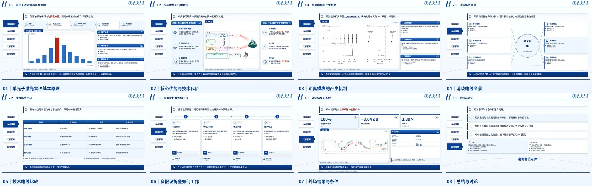
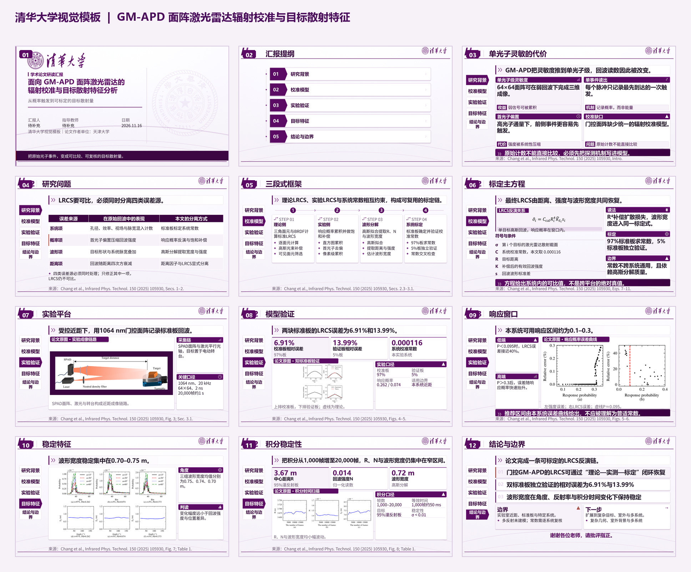

<p align="center">
  
</p>

# Academic PPT Skill

一个面向学术汇报的 Codex Skill：把论文、提纲、图片、学校身份信息与时间限制，整理成结构稳定的答辩 / 开题 / 中期 / 课程汇报幻灯片，并生成自然讲述稿。

它针对的痛点不是“再套一个 PPT 模板”，而是学术汇报里最容易出错的三件事：**版面固定层不稳定、图表被重画、讲述内容与证据边界脱节**。本项目将内容建模与视觉渲染分离：模型负责写 `deck.json`，渲染器负责固定页眉、字体层级、公式、图表、图片挂载和页序。

> 项目遵循“可验证、可编辑、可复用”的原则。默认交付原生可编辑 PowerPoint；整页图片只作为视觉备用，不冒充可编辑版本。

## Preview



预览为 9 页纯内容版（`deck_mode: content_only`），按 3×3 九宫格完整排布：已去掉封面与目录，直接按研究叙事展开
原理、技术路线、创新方法、实验验证与总结。预览主题为
`单光子激光雷达距离模糊消解技术研究进展`，示例中的汇报人和导师已匿名化。

示例内容仅用于演示排版能力，不代表真实研究成果或学校官方背书。

## Showcase



一个 12 页实验类答辩 deck：封面、目录、9 个内容页和结论页。内容来自 *Infrared Physics & Technology* 150 (2025) 105930 的 GM-APD 面阵激光雷达论文，使用 `assets/themes/tsinghua_purple/` 与 `defense` 字号档（正文 24 pt、标题 32–40 pt），覆盖研究问题、三段式标定框架、标定公式、实验平台、双标准板验证、响应窗口与积分稳定性。

- 导航：`meta.navigation_mode: sidebar`，五项小目录全程定位章节。
- 质检：PowerPoint 实机渲染 12/12 页成功；原生 PPTX 与无障碍检查均为 0 错误、0 警告；设计体检 86/100（A）。
- 复用：主题、官方字标来源与校徽说明见 [`assets/themes/tsinghua_purple/`](assets/themes/tsinghua_purple/)，可直接替换成自己的内容。
- 说明：本示例仅演示学校视觉模板的接入方式；**论文作者单位为天津大学**，不代表清华大学署名、隶属或官方背书。PPTX 与论文原图文件不随仓库分发，总览图仅用于展示版面。

## Features

- **结构化内容输入**：`deck.json` 分别记录章节、页面主张、证据、边界、图片来源和逐页讲稿。
- **源材料抽取**：PDF / DOCX / PPTX / Markdown / 图片文件夹 → `source.md`、`source_manifest.json`、`figures/`，让图片和来源可追溯。
- **PPTX 主题导入**：从用户现有 `.pptx` 读取 theme colors、major/minor fonts 和 slide size，生成可审查的 `theme.json` 草稿。
- **院校品牌资产**：`build_brand_lockup.py` 支持本地图、直链或 Wikimedia Commons 搜索；可直用官方横式字标（`--lockup`），也可自动去白底、裁切、合成“校徽 + 校名”字标并写回主题。
- **完整版 / 纯内容版**：`deck_mode: full` 生成封面与目录；`deck_mode: content_only` 从正文页开始，适合作品集嵌入、长图预览和已有封面的场合。
- **三种导航模式**：`meta.navigation_mode` 明确选择 `sidebar`（目录页 + 左侧常驻小目录）、`dividers`（目录页 + 每章独立章节分隔页）或 `hybrid`（两者结合）；不再要求用户理解底层 `layout.sidebar_mode`。
- **固定学术版面**：封面、提纲、固定页眉、章节号、小目录、页脚和院校身份层由主题统一控制。
- **多种证据型版式**：`figure`、`figure_flow`、`concept`、`formula`、`balance`、`pipeline`、`compare`、`metrics`、`timeline`、`references` 等。
- **题材驱动叙事**：`meta.genre` 支持 experiment / systems / theory / empirical / survey / design / humanities / clinical，并按题材给出叙事弧和证据页提醒，而不是固定每页格式。
- **版式变体**：同一内容契约可用不同构图，例如 `figure` 的 `image_left` / `image_right` / `chart`，`quote` 的 `centered` / `split`。
- **人文学科引文页**：`quote` 版式承载引文、出处、版本说明和解读，不再把人文论证硬塞进三卡网格。
- **论文图优先**：用户提供论文时先从 `figures.json` 选图；没有论文时用 `find_figures.py` 检索 arXiv 公开论文，按 caption 渲染完整 figure 区域，并保留来源、caption 和边界。
- **语义示意图**：`sequence`、`branch`、`stack`、`ruler`、`matrix`、`cycle` 六种图理由内容驱动，渲染器只负责几何与排版；PPTX 中仍是原生形状和文本。
- **短标题与幽灵稿**：默认页眉只写 10 字以内的主题词，完整判断放在 lead；`title_mode: assertion` 是可选模式。`build_ghost_deck.py` 输出一条可在五分钟内读完的标题主张链。
- **引用与来源可追溯**：deck 级 `citations` + 页级 `cites` / `source`，页脚自动生成来源行；`source_policy` 可把缺来源的图表和借用图片升级为错误。
- **图表口径齐全**：`unit`、`sample_size`、`condition`、`source`、`error_bar` 与图表绑定，避免数字脱离实验条件。
- **样板先行**：`--sample 5` 或 `--pages 1,4,7` 先出视觉样板，确认后再生成全套，避免一次性返工。
- **Q&A 预测**：`build_qa.py` 从 claim / evidence / boundary 生成可追溯的答辩问题，每个问题都指向具体页。
- **讲解稿去 AI 味**：内置 `lieflat-less-ai-tone` 适配版审计，按 A/B/C/F 分级标出翻案腔、提示语冒号、翻译腔、长句、分号和念 PPT，并明确 X 级不改项；`build_speech.py` 自动生成 `speech_audit.md/json`。
- **原生可编辑 PPTX**：文字、形状、表格、图表和 OMML 公式均为可编辑对象，而不是整页截图。
- **公式排版**：支持 LaTeX 源 `formula_latex`，预览使用数学排版，PPTX 优先转换为 OMML。
- **投影/文档双字号档**：`document` 保留高密度阅读版；`projection` 提高实际 PPTX 字号，并通过溢出门禁要求拆页，而不是把字压小。
- **lecture 字号档**：面向现场讲解，正文目标约 18 pt；配合 `validate_pptx --lecture-audit` 检查正文、标题和脚注的物理字号。
- **defense 字号档与可读性体检**：答辩投影正文目标 24 pt、标题 32–40 pt；`scripts/audit_pptx.py` 按 PPTX 实际 run 检查全篇字号、表格和参考文献，正文达标但大量小字仍会判定 `font_upgrade`。
- **南京大学紫色主题与 16 页样例**：`assets/themes/nanjing_purple/` 使用官方书法字标与校徽（来源见 `SOURCE.md`），`examples/nanjing_optics/` 演示官方字标、真实论文图、`defense` 档与语义加粗。
- **清华紫答辩主题**：`assets/themes/tsinghua_purple/` 内置 `defense` 字号档与官方字标来源，并用 12 页 GM-APD 答辩 deck 做过 PPTX 与无障碍回归（见 Showcase）。
- **版式画廊**：`scripts/build_gallery.py` 生成 20+ 页 layout / diagram / chart 画廊，覆盖六种关系图、引文页和图文变体。
- **视觉语言提炼**：固定页眉、左侧小目录、证据卡、流程、公式面板和单点红色强调来自 Image Gen 2.6 成图的版式语法，而不是整页图片复用。
- **无障碍语义**：真实 slide title placeholder、图片语义 alt、decorative 标记、表格 header row、阅读顺序和核心文档属性。
- **真实成品质检**：`render_pptx_preview.py` 通过 PowerPoint COM 或 LibreOffice 渲染 PPTX，并与 PIL 预览做差异比较，避免“预览能过、交付跑版”。
- **可执行质量门禁**：`quality_gate.py` 汇总渲染、结构、设计、PPTX、无障碍、字号和实机预览报告，校验报告新鲜度与页数一致性，输出按页修复队列；`FAIL` 时不允许交付。
- **真实缺图提示**：没有论文原图时显示明确提示或改用文字结构，不伪造直方图、目标框、噪声曲线来凑版面。
- **答辩稿与备注**：按页生成 speaker notes 与连贯讲述稿，并检查时长和证据口径。
- **主题可替换**：内置通用学术蓝与院校示例主题，学校名称、校标、颜色和字体全部配置化，不写死在渲染器里。

## Requirements

- Python 3.10+
- Microsoft PowerPoint 或兼容的演示软件（查看 PPTX）
- 推荐安装 Microsoft Office，以获得最佳 OMML 公式转换效果

## Install

### 方式一：作为 Codex Skill 安装

```bash
git clone https://github.com/GYSoaring/academic-ppt-skill.git
```

将仓库放到 Codex 的 skills 目录：

```text
macOS / Linux:  ~/.codex/skills/academic-ppt-skill
Windows:        %USERPROFILE%\.codex\skills\academic-ppt-skill
```

然后重新加载 Codex。调用示例：

```text
使用 $academic-ppt-skill，根据这篇论文和学校素材生成 15 页开题报告。
```

如果想让 PPT 用独立章节页而不是左侧侧栏目录，直接把导航选择写进 prompt：

```text
使用 $academic-ppt-skill，根据这篇论文做一个清华大学的答辩 PPT。
导航使用 dividers：保留目录页，每章插入一张独立章节分隔页，不要左侧常驻小目录。
```

另外两种写法：`sidebar` 表示目录页加左侧常驻小目录、不插章节页；`hybrid` 表示章节页与侧栏目录同时使用，但侧栏只出现在每章第一张内容页。

### 方式二：直接在仓库中运行

```bash
python -m pip install -r requirements.txt
```

## Quick Start

从仓库根目录运行内置示例：

```bash
python scripts/extract_source.py \
  --input path/to/paper.pdf path/to/figures \
  --out outputs/zju-proposal/source_pack

python scripts/import_pptx_theme.py \
  --pptx path/to/school_template.pptx \
  --out outputs/zju-proposal/imported-theme/theme.json \
  --name "学校名称"

python scripts/build_brand_lockup.py \
  --theme outputs/zju-proposal/imported-theme/theme.json \
  --name "学校名称" \
  --latin "UNIVERSITY NAME" \
  --search-query "你的学校英文名 logo"

# 已有官方横式字标时，直接使用，不再用字体排版
python scripts/build_brand_lockup.py \
  --theme assets/themes/tsinghua_purple/theme.json \
  --name "清华大学" \
  --lockup path/to/official_lockup.png \
  --lockup-crop "0,0,236,88" \
  --recolor-lockup

python scripts/find_figures.py \
  --query "vision language action robot" \
  --out outputs/figure-pack

python scripts/suggest_figures.py \
  --deck examples/tsinghua_embodied_ai/deck.json \
  --figures outputs/figure-pack/figures.json \
  --out outputs/figure-suggestions \
  --query "vision language action robot"

python scripts/render_deck.py \
  --deck examples/zju_proposal/deck.json \
  --theme assets/themes/zju_blue/theme.json \
  --out outputs/zju-proposal \
  --profile document

python scripts/export_editable_pptx.py \
  --deck examples/zju_proposal/deck.json \
  --theme assets/themes/zju_blue/theme.json \
  --out outputs/zju-proposal \
  --pptx-name defense_deck.pptx \
  --profile document

python scripts/build_speech.py \
  --deck examples/zju_proposal/deck.json \
  --out outputs/zju-proposal

python scripts/build_ghost_deck.py \
  --deck examples/zju_proposal/deck.json \
  --out outputs/zju-proposal

python scripts/build_qa.py \
  --deck examples/zju_proposal/deck.json \
  --out outputs/zju-proposal \
  --count 10

python scripts/validate_deck.py \
  --deck examples/zju_proposal/deck.json \
  --theme assets/themes/zju_blue/theme.json \
  --render-dir outputs/zju-proposal/rendered \
  --out outputs/zju-proposal \
  --profile document

python scripts/validate_pptx.py \
  --pptx outputs/zju-proposal/defense_deck.pptx \
  --deck examples/zju_proposal/deck.json \
  --out outputs/zju-proposal

python scripts/check_accessibility.py \
  --pptx outputs/zju-proposal/defense_deck.pptx \
  --out outputs/zju-proposal

python scripts/render_pptx_preview.py \
  --pptx outputs/zju-proposal/defense_deck.pptx \
  --out outputs/zju-proposal/pptx_preview \
  --compare-dir outputs/zju-proposal/rendered \
  --strict
```

Windows PowerShell 可把行末的 `\` 改为单行命令，或在 Git Bash / WSL 中执行。

先出样板再生成全套：

```bash
python scripts/render_deck.py \
  --deck examples/zju_proposal/deck.json \
  --theme assets/themes/zju_blue/theme.json \
  --out outputs/zju-proposal-sample \
  --sample 5

python scripts/export_editable_pptx.py \
  --deck examples/zju_proposal/deck.json \
  --theme assets/themes/zju_blue/theme.json \
  --out outputs/zju-proposal-sample \
  --pptx-name sample.pptx \
  --sample 5
```

`--pages 1,4,7` 可只出指定页。样板确认后再去掉该参数生成全套。

## Output

一次完整生成通常包含：

```text
outputs/<project>/
|-- deck.json                   # 结构化内容与逐页讲稿
|-- source_pack/                # 可选的论文/图表抽取结果
|-- rendered/slide_01.png ...   # 确定性版面预览
|-- contact_sheet.jpg           # 全篇缩略图
|-- defense_deck.pptx           # 原生可编辑 PowerPoint
|-- pptx_preview/               # PowerPoint/LibreOffice 实际渲染页
|   `-- pptx_render_report.json # 实际渲染、空白页和预览差异
|-- speaker_notes.md            # 逐页演讲备注
|-- defense_script.md           # 连续答辩稿
|-- speech_audit.md             # 分级去 AI 味与口播节奏报告
|-- ghost_deck.md               # 五分钟可读完的标题主张链
|-- qa.md                       # 可追溯的答辩问题预测
|-- render_report.json          # 溢出、缺图和版面检查
|-- pptx_validation_report.json # PPTX 原生对象与完整性检查
|-- accessibility_report.json   # 标题、alt、表格 header、阅读顺序检查
`-- agent_brief.md              # 无法运行脚本时的可移植任务书
```

可选生成 `defense_deck_raster.pptx`。它把整页预览作为图片嵌入，只用于保住视觉版式；不要把该文件当成可编辑交付。

## Themes

| Theme | Purpose |
|---|---|
| `assets/themes/academic_blue/theme.json` | 通用学术蓝，不含院校标识 |
| `assets/themes/zju_blue/theme.json` | 求是蓝开题报告示例 |
| `assets/themes/tju_blue/theme.json` | 北洋蓝答辩示例 |
| `assets/themes/tsinghua_purple/theme.json` | 清华紫答辩示例，含 `defense` 字号档 |

新增学校主题时，请复制最接近的主题目录，替换颜色、身份资产和字体候选；不要修改共享渲染器。主题契约见 [`references/theme-authoring.md`](references/theme-authoring.md)。

字体不随仓库分发。主题中的绝对路径是候选顺序，找不到时会继续回退到系统字体。

## Design Contract

- 页眉章节号与标题字号一致；编号缩短时，标题同步缩短。
- 封面不放页眉和小目录；内容页按 `meta.navigation_mode` 使用侧栏、章节分隔页或两者组合。
- `**强调**` 只表示红色粗体，不自动添加下划线。
- 深色结论带上的普通文字、强调文字和弱化文字都必须切换为高对比前景色。
- 一个页面只承担一个主要论证任务；真实图片优先于装饰性占位图。
- 没有实测图但确有机制关系时，使用带标签的 `concept` 示意图；没有关系时用 `footer` / `output` 或文字结构，不塞无关占位图。
- 公式页必须同时给出公式、符号说明、适用条件和边界；`tₑ` 这类真实下标不能被写成代码式 `t_e`。
- `projection` / `lecture` / `defense` 模式如果触发溢出，必须拆页或删减次要文本；不得用更小字号强行塞入。
- `defense` 档只对语义正文区间加粗；脚注、参考文献元数据、caption 和微标签保持常规字重。`text.body_bold_min_px` / `body_bold_max_px` 控制加粗区间。
- 图文页可用 `image_width_ratio` 或 `rail_ratio` 把主图区调到 45%–82%；源图始终 contain，不裁切、不拉伸。`grid` 用 `span` / `footer` / `output` 打破等宽空卡。
- 每页必须有真实 title placeholder；内容图必须有语义 alt；装饰背景必须标记 decorative；对比表必须有 header row。
- 论文曲线、硬件照片、实验场景和实测数据不得重绘。
- 未提供的指标、引用、排名和实验结论不得生成或补造。

这些规则集中记录在 [`references/visual-language.md`](references/visual-language.md)、[`references/style-contract.md`](references/style-contract.md) 与 [`references/layout-catalog.md`](references/layout-catalog.md)。

## Editable PPTX

原生导出会把以下元素写成 PowerPoint 对象：

- 文本、标题、编号、页眉、页脚
- 面板、线条、编号块和结论带
- 原生表格
- 原生柱状图、折线图、曲线图
- 可编辑 OMML 公式（失败时回退为 Cambria Math 文本）
- 演讲者备注

图片资产、纸张纹理、院校校标和背景母题仍以图片形式嵌入，这是视觉素材边界，不是整页截图。

## Quality Gate

质量不是靠“再生成一版”碰出来的。每个阶段都要有可复核的报告，并且报告必须比 deck、主题、图片和生成脚本新；旧报告不算证据。

```bash
python scripts/quality_gate.py \
  --deck outputs/project/deck.json \
  --theme assets/themes/tsinghua_purple/theme.json \
  --out outputs/project \
  --profile defense \
  --stage final
```

`--stage` 按 `sample → deck → pptx → final` 逐步收紧：样板阶段只查渲染和联系表；全套阶段加结构校验与设计体检；PPTX 阶段加原生对象、无障碍和答辩字号；最终阶段加 PowerPoint 实机渲染、讲稿时长和 Q&A。

输出：

- `quality_gate.json`：机器可读的检查、问题与计数。
- `quality_gate.md`：按页修复队列、下一步动作和停止条件。

规则很简单：一轮只修一类问题；迭代时可以只重渲染问题页，但交付前必须全量渲染；同一页两次修不好就拆页或删内容，不再降字号；主题和几何在阶段 2 后冻结；连续两次 PASS 就停手。弱模型按修复队列执行、只读对应的一篇参考、不发明新版式；完整方法见 [`references/iteration-playbook.md`](references/iteration-playbook.md)。

## Testing

建议在发布或改动渲染器后至少执行：

```bash
python -m py_compile scripts/*.py
python -m pytest -q
python scripts/render_deck.py --deck examples/zju_proposal/deck.json --theme assets/themes/academic_blue/theme.json --out work/smoke --profile document
python scripts/export_editable_pptx.py --deck examples/zju_proposal/deck.json --theme assets/themes/academic_blue/theme.json --out work/smoke --pptx-name defense_deck.pptx --profile document
python scripts/validate_pptx.py --pptx work/smoke/defense_deck.pptx --deck examples/zju_proposal/deck.json --out work/smoke
python scripts/check_accessibility.py --pptx work/smoke/defense_deck.pptx --out work/smoke
python scripts/render_pptx_preview.py --pptx work/smoke/defense_deck.pptx --out work/smoke/pptx_preview --compare-dir work/smoke/rendered --strict
python scripts/package_skill.py --out dist/academic-ppt-skill-v0.1.0.zip --version 0.1.0
python scripts/audit_pptx.py --pptx work/nanjing_defense/nanjing_optics_defense.pptx --out work/nanjing_defense
```

`work/`、`outputs/`、PPTX、渲染图和报告都被 `.gitignore` 排除。

## Scope And Limits

- 本项目不会替代用户对论文事实、引用、实验条件和学校规范的最终核验。
- 生成式图片可以作为机制概念示意，但不能承载精确中文标签、坐标、公式或引用。
- 不同学校的品牌规范、字体安装和 Office 版本可能造成渲染差异；提交前应在目标电脑复核。
- 模板中的院校标识仅用于展示主题能力，不代表任何学校、院系或导师对本项目的认证。

## License

源代码与文档采用 [MIT License](LICENSE)。第三方院校名称、校标、校名组合及其他品牌素材不在 MIT 授权范围内，详见 [NOTICE.md](NOTICE.md)。
