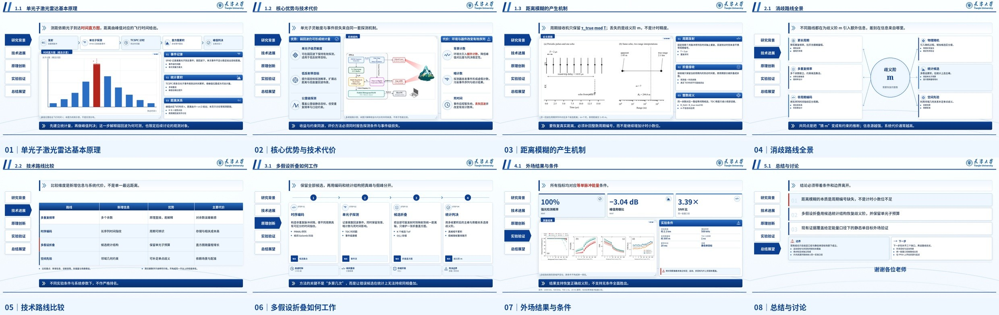

<p align="center">
  
</p>

# Academic PPT Skill

一个面向学术汇报的 Codex Skill：把论文、提纲、图片、学校身份信息与时间限制，整理成结构稳定的答辩 / 开题 / 中期 / 课程汇报幻灯片，并生成自然讲述稿。

它针对的痛点不是“再套一个 PPT 模板”，而是学术汇报里最容易出错的三件事：**版面固定层不稳定、图表被重画、讲述内容与证据边界脱节**。本项目将内容建模与视觉渲染分离：模型负责写 `deck.json`，渲染器负责固定页眉、字体层级、公式、图表、图片挂载和页序。

> 项目遵循“可验证、可编辑、可复用”的原则。默认交付原生可编辑 PowerPoint；整页图片只作为视觉备用，不冒充可编辑版本。

## Preview



预览为 9 页纯内容版（`deck_mode: content_only`），按 3×3 九宫格完整排布：已去掉封面与目录，直接按研究叙事展开
原理、技术路线、创新方法、实验验证与总结。预览主题为
`单光子激光雷达距离模糊消解技术研究进展`，示例中的汇报人和导师已匿名化。

示例内容仅用于演示排版能力，不代表真实研究成果或学校官方背书。

## Features

- **结构化内容输入**：`deck.json` 分别记录章节、页面主张、证据、边界、图片来源和逐页讲稿。
- **完整版 / 纯内容版**：`deck_mode: full` 生成封面与目录；`deck_mode: content_only` 从正文页开始，适合作品集嵌入、长图预览和已有封面的场合。
- **固定学术版面**：封面、提纲、固定页眉、章节号、小目录、页脚和院校身份层由主题统一控制。
- **多种证据型版式**：`figure`、`figure_flow`、`balance`、`pipeline`、`compare`、`metrics`、`timeline`、`references` 等。
- **原生可编辑 PPTX**：文字、形状、表格、图表和 OMML 公式均为可编辑对象，而不是整页截图。
- **公式排版**：支持 LaTeX 源 `formula_latex`，预览使用数学排版，PPTX 优先转换为 OMML。
- **真实缺图提示**：没有论文原图时显示明确提示或改用文字结构，不伪造直方图、目标框、噪声曲线来凑版面。
- **答辩稿与备注**：按页生成 speaker notes 与连贯讲述稿，并检查时长和证据口径。
- **主题可替换**：内置通用学术蓝与院校示例主题，学校名称、校标、颜色和字体全部配置化，不写死在渲染器里。

## Requirements

- Python 3.10+
- Microsoft PowerPoint 或兼容的演示软件（查看 PPTX）
- 推荐安装 Microsoft Office，以获得最佳 OMML 公式转换效果

## Install

### 方式一：作为 Codex Skill 安装

```bash
git clone https://github.com/GYSoaring/academic-ppt-skill.git
```

将仓库放到 Codex 的 skills 目录：

```text
macOS / Linux:  ~/.codex/skills/academic-ppt-skill
Windows:        %USERPROFILE%\.codex\skills\academic-ppt-skill
```

然后重新加载 Codex。调用示例：

```text
使用 $academic-ppt-skill，根据这篇论文和学校素材生成 15 页开题报告。
```

### 方式二：直接在仓库中运行

```bash
python -m pip install -r requirements.txt
```

## Quick Start

从仓库根目录运行内置示例：

```bash
python scripts/render_deck.py \
  --deck examples/zju_proposal/deck.json \
  --theme assets/themes/zju_blue/theme.json \
  --out outputs/zju-proposal

python scripts/export_editable_pptx.py \
  --deck examples/zju_proposal/deck.json \
  --theme assets/themes/zju_blue/theme.json \
  --out outputs/zju-proposal \
  --pptx-name defense_deck.pptx

python scripts/build_speech.py \
  --deck examples/zju_proposal/deck.json \
  --out outputs/zju-proposal

python scripts/validate_deck.py \
  --deck examples/zju_proposal/deck.json \
  --theme assets/themes/zju_blue/theme.json \
  --render-dir outputs/zju-proposal/rendered \
  --out outputs/zju-proposal

python scripts/validate_pptx.py \
  --pptx outputs/zju-proposal/defense_deck.pptx \
  --deck examples/zju_proposal/deck.json \
  --out outputs/zju-proposal
```

Windows PowerShell 可把行末的 `\` 改为单行命令，或在 Git Bash / WSL 中执行。

## Output

一次完整生成通常包含：

```text
outputs/<project>/
|-- deck.json                   # 结构化内容与逐页讲稿
|-- rendered/slide_01.png ...   # 确定性版面预览
|-- contact_sheet.jpg           # 全篇缩略图
|-- defense_deck.pptx           # 原生可编辑 PowerPoint
|-- speaker_notes.md            # 逐页演讲备注
|-- defense_script.md           # 连续答辩稿
|-- render_report.json          # 溢出、缺图和版面检查
|-- pptx_validation_report.json # PPTX 原生对象与完整性检查
`-- agent_brief.md              # 无法运行脚本时的可移植任务书
```

可选生成 `defense_deck_raster.pptx`。它把整页预览作为图片嵌入，只用于保住视觉版式；不要把该文件当成可编辑交付。

## Themes

| Theme | Purpose |
|---|---|
| `assets/themes/academic_blue/theme.json` | 通用学术蓝，不含院校标识 |
| `assets/themes/zju_blue/theme.json` | 求是蓝开题报告示例 |
| `assets/themes/tju_blue/theme.json` | 北洋蓝答辩示例 |

新增学校主题时，请复制最接近的主题目录，替换颜色、身份资产和字体候选；不要修改共享渲染器。主题契约见 [`references/theme-authoring.md`](references/theme-authoring.md)。

字体不随仓库分发。主题中的绝对路径是候选顺序，找不到时会继续回退到系统字体。

## Design Contract

- 页眉章节号与标题字号一致；编号缩短时，标题同步缩短。
- 封面不放页眉和小目录；内容页从第三页起固定显示五项小目录。
- `**强调**` 只表示红色粗体，不自动添加下划线。
- 深色结论带上的普通文字、强调文字和弱化文字都必须切换为高对比前景色。
- 一个页面只承担一个主要论证任务；真实图片优先于装饰性占位图。
- 论文曲线、硬件照片、实验场景和实测数据不得重绘。
- 未提供的指标、引用、排名和实验结论不得生成或补造。

这些规则集中记录在 [`references/style-contract.md`](references/style-contract.md) 与 [`references/layout-catalog.md`](references/layout-catalog.md)。

## Editable PPTX

原生导出会把以下元素写成 PowerPoint 对象：

- 文本、标题、编号、页眉、页脚
- 面板、线条、编号块和结论带
- 原生表格
- 原生柱状图、折线图、曲线图
- 可编辑 OMML 公式（失败时回退为 Cambria Math 文本）
- 演讲者备注

图片资产、纸张纹理、院校校标和背景母题仍以图片形式嵌入，这是视觉素材边界，不是整页截图。

## Testing

建议在发布或改动渲染器后至少执行：

```bash
python -m py_compile scripts/*.py
python scripts/render_deck.py --deck examples/zju_proposal/deck.json --theme assets/themes/academic_blue/theme.json --out work/smoke
python scripts/export_editable_pptx.py --deck examples/zju_proposal/deck.json --theme assets/themes/academic_blue/theme.json --out work/smoke --pptx-name defense_deck.pptx
python scripts/validate_pptx.py --pptx work/smoke/defense_deck.pptx --deck examples/zju_proposal/deck.json --out work/smoke
```

`work/`、`outputs/`、PPTX、渲染图和报告都被 `.gitignore` 排除。

## Scope And Limits

- 本项目不会替代用户对论文事实、引用、实验条件和学校规范的最终核验。
- 生成式图片可以作为机制概念示意，但不能承载精确中文标签、坐标、公式或引用。
- 不同学校的品牌规范、字体安装和 Office 版本可能造成渲染差异；提交前应在目标电脑复核。
- 模板中的院校标识仅用于展示主题能力，不代表任何学校、院系或导师对本项目的认证。

## License

源代码与文档采用 [MIT License](LICENSE)。第三方院校名称、校标、校名组合及其他品牌素材不在 MIT 授权范围内，详见 [NOTICE.md](NOTICE.md)。
